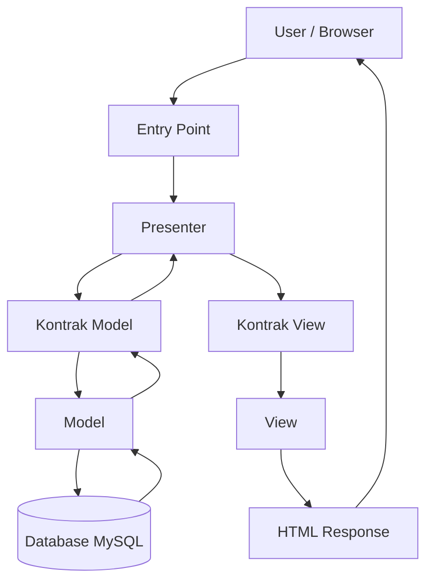

# MVP Rekrutmen Karyawan

**Nama:** Luthfi Aulia Jodi  
**NIM:** 2521743  
**Proyek:** Implementasi Model–View–Presenter (MVP) menggunakan PHP dan MySQL

## Deskripsi Program

Program ini merupakan aplikasi sederhana untuk mengelola data rekrutmen karyawan menggunakan bahasa pemrograman PHP, database MySQL, dan arsitektur **Model–View–Presenter (MVP)**.

Aplikasi memiliki dua modul utama, yaitu **Kandidat** dan **Departemen**. Modul Kandidat digunakan untuk mengelola data pelamar kerja, sedangkan modul Departemen digunakan untuk mengelola informasi departemen perusahaan.

Setiap modul memiliki fitur CRUD (*Create, Read, Update, Delete*), yang meliputi menambahkan data, menampilkan daftar data, mengubah data, dan menghapus data. Kedua modul menggunakan database `mvp_kandidat_db`, tetapi masing-masing memiliki Model, View, Presenter, dan contract/interface sendiri.

Penerapan MVP mengikuti prinsip **Strict Passive View**. View hanya bertugas menampilkan HTML berdasarkan data yang diberikan Presenter. View tidak berhubungan langsung dengan Model atau entity, serta tidak melakukan pengolahan koleksi data menggunakan `foreach` maupun `count()`.

## Daftar Isi

1. [Struktur Folder](#1-struktur-folder)
2. [Desain Program](#2-desain-program)
   - [2.1 Arsitektur MVP](#21-arsitektur-mvp)
   - [2.2 Konsep Strict Passive View](#22-konsep-strict-passive-view)
   - [2.3 Entity Kandidat](#23-entity-kandidat)
   - [2.4 Entity Departemen](#24-entity-departemen)
   - [2.5 Contract atau Interface](#25-contract-atau-interface)
   - [2.6 Pembagian Tanggung Jawab](#26-pembagian-tanggung-jawab)
   - [2.7 Fitur Program](#27-fitur-program)
   - [2.8 Struktur Database](#28-struktur-database)
3. [Alur Program](#3-alur-program)
   - [3.1 Alur Utama](#31-alur-utama)
   - [3.2 Alur Modul Kandidat](#32-alur-modul-kandidat)
   - [3.3 Alur Modul Departemen](#33-alur-modul-departemen)
4. [Cara Menjalankan](#4-cara-menjalankan)
5. [Dokumentasi Program](#5-dokumentasi-program)
6. [Catatan dan Batasan](#6-catatan-dan-batasan)

---

## 1. Struktur Folder

Struktur folder setelah modul Departemen digabungkan dengan starter project Kandidat:

```text
MVP-KANDIDAT/
├── models/
│   ├── DB.php
│   ├── Kandidat.php
│   ├── KontrakModel.php
│   ├── TabelKandidat.php
│   ├── Departemen.php
│   ├── KontrakModelDepartemen.php
│   └── TabelDepartemen.php
│
├── presenters/
│   ├── KontrakPresenter.php
│   ├── PresenterKandidat.php
│   ├── KontrakPresenterDepartemen.php
│   └── PresenterDepartemen.php
│
├── views/
│   ├── KontrakView.php
│   ├── ViewKandidat.php
│   ├── KontrakViewDepartemen.php
│   └── ViewDepartemen.php
│
├── template/
│   ├── skin.html
│   └── form.html
│
├── index.php
├── departemen.php
└── README.md
```

### Keterangan folder dan file

| Folder/File | Isi atau tanggung jawab |
|---|---|
| `models/` | Entity, contract Model, dan implementasi Model yang berhubungan dengan database. |
| `models/DB.php` | Menyediakan koneksi serta fungsi untuk menjalankan query database. |
| `models/Kandidat.php` | Entity untuk merepresentasikan satu data kandidat. |
| `models/TabelKandidat.php` | Mengambil dan memanipulasi data pada tabel `kandidat`. |
| `models/Departemen.php` | Entity untuk merepresentasikan satu data departemen. |
| `models/TabelDepartemen.php` | Mengambil dan memanipulasi data pada tabel `departemen`. |
| `presenters/` | Contract Presenter dan implementasi Presenter untuk setiap modul. |
| `views/` | Contract View dan implementasi View untuk setiap modul. |
| `template/skin.html` | Template halaman daftar kandidat. |
| `template/form.html` | Template form tambah dan ubah kandidat. |
| `index.php` | Entry point untuk request modul Kandidat. |
| `departemen.php` | Entry point untuk request modul Departemen. |
| `README.md` | Dokumentasi desain dan alur program. |

## 2. Desain Program

### 2.1 Arsitektur MVP

Program menerapkan pola **Model–View–Presenter (MVP)**. Setiap bagian memiliki tanggung jawab yang berbeda.

| Komponen | File | Tanggung jawab |
|---|---|---|
| Model | `TabelKandidat.php`, `TabelDepartemen.php` | Menjalankan query dan mengelola data database. |
| Entity | `Kandidat.php`, `Departemen.php` | Merepresentasikan satu objek data beserta atribut dan getter-nya. |
| View | `ViewKandidat.php`, `ViewDepartemen.php` | Menampilkan halaman HTML berdasarkan data yang diterima. |
| Presenter | `PresenterKandidat.php`, `PresenterDepartemen.php` | Menghubungkan Model dan View, mengolah data tampilan, serta mengatur proses CRUD. |
| Entry Point | `index.php`, `departemen.php` | Menerima request HTTP dan meneruskannya ke Presenter. |
| Contract | File `Kontrak*.php` | Menentukan operasi yang wajib disediakan oleh komponen. |

Gambaran hubungan komponen:



Diagram tersebut berlaku untuk kedua modul. Entry point Kandidat adalah `index.php`, sedangkan entry point Departemen adalah `departemen.php`.

### 2.2 Konsep Strict Passive View

Strict Passive View diterapkan agar View hanya bertanggung jawab atas penyajian tampilan. Seluruh pengambilan data dan pengolahan data dilakukan oleh Model dan Presenter.

Ketentuan penerapannya:

1. View tidak melakukan `require_once` terhadap file Model atau entity.
2. View tidak mengakses database atau menjalankan query.
3. View tidak melakukan perulangan data menggunakan `foreach`.
4. View tidak menghitung jumlah data menggunakan `count()`.
5. Presenter menyiapkan data yang diperlukan View, termasuk HTML baris tabel dan data untuk form.
6. Presenter berkomunikasi dengan Model dan View melalui contract/interface.

Contoh alur pada modul Kandidat:

- `PresenterKandidat` mengambil daftar kandidat melalui `KontrakModel`.
- Presenter melakukan perulangan data dan menyusun baris HTML.
- Presenter mengirim hasilnya ke `ViewKandidat` melalui `renderDaftar()`.
- `ViewKandidat` memasukkan hasil tersebut ke placeholder `{{TABLE_ROWS}}` dan `{{TOTAL_DATA}}` pada `skin.html`.

Dengan demikian, View tidak perlu mengetahui class `Kandidat` maupun cara data diambil dari database.

### 2.3 Entity Kandidat

Entity `Kandidat` merepresentasikan satu orang kandidat atau pelamar kerja.

**Atribut kandidat**

| Atribut | Tipe | Keterangan |
|---|---|---|
| `id` | `int` | ID unik kandidat. |
| `nama` | `string` | Nama kandidat. |
| `posisi` | `string` | Posisi pekerjaan yang dilamar. |
| `domisili` | `string` | Domisili kandidat. |
| `skorTes` | `int` | Nilai tes kandidat. |
| `pengalamanTahun` | `int` | Lama pengalaman kerja dalam tahun. |

**Method yang digunakan**

| Method | Fungsi |
|---|---|
| `Kandidat(...)` | Constructor untuk mengisi atribut kandidat. |
| `getId()` | Mengambil ID kandidat. |
| `getNama()` | Mengambil nama kandidat. |
| `getPosisi()` | Mengambil posisi yang dilamar. |
| `getDomisili()` | Mengambil domisili kandidat. |
| `getSkorTes()` | Mengambil skor tes. |
| `getPengalamanTahun()` | Mengambil pengalaman kerja. |

### 2.4 Entity Departemen

Entity `Departemen` merepresentasikan satu departemen dalam perusahaan.

**Atribut departemen**

| Atribut | Tipe | Keterangan |
|---|---|---|
| `id` | `int` | ID unik departemen. |
| `namaDepartemen` | `string` | Nama departemen. |
| `deskripsi` | `string` | Penjelasan mengenai departemen. |
| `lokasi` | `string` | Lokasi departemen. |

**Method yang digunakan**

| Method | Fungsi |
|---|---|
| `Departemen(...)` | Constructor untuk mengisi atribut departemen. |
| `getId()` | Mengambil ID departemen. |
| `getNamaDepartemen()` | Mengambil nama departemen. |
| `getDeskripsi()` | Mengambil deskripsi departemen. |
| `getLokasi()` | Mengambil lokasi departemen. |

### 2.5 Contract atau Interface

Setiap komponen utama menggunakan contract agar operasi yang tersedia ditentukan melalui interface.

| Contract | Diimplementasikan oleh | Fungsi utama |
|---|---|---|
| `KontrakModel` | `TabelKandidat` | Menentukan operasi pengelolaan data kandidat. |
| `KontrakPresenter` | `PresenterKandidat` | Menentukan operasi yang disediakan Presenter Kandidat. |
| `KontrakView` | `ViewKandidat` | Menentukan method untuk menampilkan daftar dan form kandidat. |
| `KontrakModelDepartemen` | `TabelDepartemen` | Menentukan operasi pengelolaan data departemen. |
| `KontrakPresenterDepartemen` | `PresenterDepartemen` | Menentukan operasi yang disediakan Presenter Departemen. |
| `KontrakViewDepartemen` | `ViewDepartemen` | Menentukan method untuk menampilkan daftar dan form departemen. |

Presenter menerima Model dan View melalui constructor (*dependency injection*) dengan tipe contract. Dengan demikian, Presenter bergantung pada interface, bukan pada implementasi konkret tertentu.

### 2.6 Pembagian Tanggung Jawab

| Bagian | File | Tugas |
|---|---|---|
| Koneksi database | `DB.php` | Menyediakan koneksi database dan eksekusi query. |
| Model Kandidat | `TabelKandidat.php` | Operasi `SELECT`, `INSERT`, `UPDATE`, dan `DELETE` pada tabel kandidat. |
| Model Departemen | `TabelDepartemen.php` | Operasi `SELECT`, `INSERT`, `UPDATE`, dan `DELETE` pada tabel departemen. |
| Presenter Kandidat | `PresenterKandidat.php` | Menyiapkan data daftar/form dan menjalankan perintah CRUD kandidat melalui Model. |
| Presenter Departemen | `PresenterDepartemen.php` | Menyiapkan data daftar/form dan menjalankan perintah CRUD departemen melalui Model. |
| View Kandidat | `ViewKandidat.php` | Mengisi template HTML kandidat menggunakan data dari Presenter. |
| View Departemen | `ViewDepartemen.php` | Menghasilkan tampilan daftar dan form departemen. |
| Entry point Kandidat | `index.php` | Mengatur request GET dan POST untuk modul Kandidat. |
| Entry point Departemen | `departemen.php` | Mengatur request GET dan POST untuk modul Departemen. |

### 2.7 Fitur Program

Aplikasi mempunyai dua modul dengan fitur berikut.

**Modul Kandidat**

| Operasi | Fitur | Fungsi |
|---|---|---|
| Create | Tambah Kandidat | Menambahkan kandidat baru ke database. |
| Read | Daftar Kandidat | Menampilkan data kandidat dari database. |
| Read | Detail untuk Form Edit | Mengambil data kandidat berdasarkan ID untuk mengisi form. |
| Update | Ubah Kandidat | Memperbarui data kandidat berdasarkan ID. |
| Delete | Hapus Kandidat | Menghapus data kandidat berdasarkan ID. |

Daftar kandidat diurutkan berdasarkan `skorTes` secara menurun, kemudian `id` secara menaik.

**Modul Departemen**

| Operasi | Fitur | Fungsi |
|---|---|---|
| Create | Tambah Departemen | Menambahkan departemen baru ke database. |
| Read | Daftar Departemen | Menampilkan seluruh departemen. |
| Read | Form Edit Departemen | Mengambil data departemen berdasarkan ID untuk mengisi form. |
| Update | Ubah Departemen | Memperbarui data departemen berdasarkan ID. |
| Delete | Hapus Departemen | Menghapus departemen berdasarkan ID. |

### 2.8 Struktur Database

Aplikasi menggunakan database MySQL bernama `mvp_kandidat_db`.

**Tabel `kandidat`**

| Kolom | Keterangan |
|---|---|
| `id` | Identitas kandidat. |
| `nama` | Nama kandidat. |
| `posisi` | Posisi yang dilamar. |
| `domisili` | Domisili kandidat. |
| `skorTes` | Nilai tes. |
| `pengalamanTahun` | Pengalaman kerja dalam tahun. |

**Tabel `departemen`**

| Kolom | Tipe | Keterangan |
|---|---|---|
| `id` | `INT AUTO_INCREMENT PRIMARY KEY` | Identitas departemen. |
| `nama_departemen` | `VARCHAR(100)` | Nama departemen. |
| `deskripsi` | `TEXT` | Deskripsi departemen. |
| `lokasi` | `VARCHAR(100)` | Lokasi departemen. |
| `created_at` | `TIMESTAMP` | Waktu pembuatan data, dengan nilai awal waktu saat data dibuat. |

Tabel `departemen` tidak memiliki foreign key ke tabel `kandidat`. Kedua tabel dikelola sebagai modul yang terpisah dalam satu aplikasi.

SQL untuk membuat tabel Departemen:

```sql
CREATE TABLE departemen (
    id INT AUTO_INCREMENT PRIMARY KEY,
    nama_departemen VARCHAR(100) NOT NULL,
    deskripsi TEXT NOT NULL,
    lokasi VARCHAR(100) NOT NULL,
    created_at TIMESTAMP DEFAULT CURRENT_TIMESTAMP
);
```

## 3. Alur Program

### 3.1 Alur Utama

Ketika aplikasi dibuka, browser mengirim request ke entry point sesuai modul yang ingin digunakan.

```text
Mulai
  ↓
User membuka aplikasi
  ↓
Memilih modul Kandidat atau Departemen
  ↓
Entry point menerima request
  ↓
Entry point membuat Model, View, dan Presenter
  ↓
Presenter memproses request
  ↓
Presenter berkomunikasi dengan Model/View melalui contract
  ↓
Model mengakses database jika diperlukan
  ↓
Presenter menyiapkan data untuk View
  ↓
View menghasilkan HTML
  ↓
HTML dikirim ke browser
  ↓
Selesai / menunggu request berikutnya
```

### 3.2 Alur Modul Kandidat

Entry point modul Kandidat adalah `index.php`.

#### 3.2.1 Menampilkan Daftar Kandidat (Read)

1. User membuka `index.php`.
2. `index.php` membuat object `TabelKandidat`, `ViewKandidat`, dan `PresenterKandidat`.
3. Entry point memanggil `tampilkanKandidat()` pada Presenter.
4. Presenter meminta data melalui `getAllKandidat()` pada Model.
5. Model menjalankan query `SELECT` pada tabel `kandidat`.
6. Setiap baris database dipetakan menjadi object `Kandidat`.
7. Presenter menghitung jumlah data dan menyusun HTML setiap baris tabel.
8. Presenter mengirim HTML baris dan jumlah data kepada View melalui `renderDaftar()`.
9. View memasukkan data ke placeholder `{{TABLE_ROWS}}` dan `{{TOTAL_DATA}}` dalam `template/skin.html`.
10. Hasil HTML dikirim ke browser.

#### 3.2.2 Menambah Kandidat (Create)

1. User memilih tombol **Tambah Kandidat**.
2. Browser membuka `index.php?screen=add`.
3. Presenter menampilkan form kosong melalui View.
4. User mengisi nama, posisi, domisili, skor tes, dan pengalaman tahun.
5. Form mengirim request POST dengan `action=tambah`.
6. `index.php` membaca data POST dan memanggil `tambahKandidat()` pada Presenter.
7. Presenter meneruskan data ke `addKandidat()` pada Model.
8. Model menjalankan query `INSERT` menggunakan prepared statement.
9. Setelah proses selesai, Presenter mengarahkan browser kembali ke `index.php`.

#### 3.2.3 Mengubah Kandidat (Update)

1. User menekan tombol **Edit** pada baris kandidat.
2. Browser membuka `index.php?screen=edit&id=...`.
3. Presenter meminta data berdasarkan ID melalui `getKandidatById()`.
4. Model menjalankan query `SELECT` berdasarkan ID dan mengembalikan object `Kandidat`.
5. Presenter mengambil nilai atribut melalui getter dan menyusun array data form.
6. View menampilkan form yang sudah terisi data sebelumnya (*prefill*).
7. User mengubah data lalu mengirim form dengan `action=ubah`.
8. `index.php` meneruskan input ke `ubahKandidat()` pada Presenter.
9. Presenter memanggil `updateKandidat()` pada Model.
10. Model menjalankan query `UPDATE` menggunakan prepared statement, kemudian Presenter mengarahkan browser kembali ke daftar kandidat.

#### 3.2.4 Menghapus Kandidat (Delete)

1. User menekan tombol **Hapus** pada baris kandidat.
2. Browser menampilkan konfirmasi penghapusan.
3. Jika dikonfirmasi, form mengirim request POST dengan `action=hapus` dan ID kandidat.
4. `index.php` memanggil `hapusKandidat()` pada Presenter.
5. Presenter meneruskan ID ke `deleteKandidat()` pada Model.
6. Model menjalankan query `DELETE` menggunakan prepared statement.
7. Presenter mengarahkan browser kembali ke daftar kandidat.

### 3.3 Alur Modul Departemen

Entry point modul Departemen adalah `departemen.php`. Modul ini menggunakan Model, View, Presenter, dan contract khusus Departemen.

#### 3.3.1 Menampilkan Daftar Departemen (Read)

1. User membuka `departemen.php`.
2. Entry point membuat object `TabelDepartemen`, `ViewDepartemen`, dan `PresenterDepartemen`.
3. Entry point memanggil `tampilkanDepartemen()` pada Presenter.
4. Presenter meminta daftar data melalui `getAllDepartemen()` pada Model.
5. Model menjalankan query `SELECT` dan memetakan setiap baris menjadi object `Departemen`.
6. Presenter mengolah daftar data, menghitung total departemen, dan membuat HTML baris tabel.
7. Presenter mengirim HTML dan jumlah data ke View melalui `renderDaftar()`.
8. View menghasilkan halaman daftar departemen.

#### 3.3.2 Menambah Departemen (Create)

1. User memilih tombol **Tambah Departemen**.
2. Browser membuka `departemen.php?screen=add`.
3. Presenter meminta View menampilkan form kosong.
4. User mengisi nama departemen, deskripsi, dan lokasi.
5. Form mengirim request POST dengan `action=tambah`.
6. `departemen.php` membaca input dan memanggil `tambahDepartemen()` pada Presenter.
7. Presenter memeriksa agar seluruh field tidak kosong.
8. Presenter memanggil `addDepartemen()` pada Model.
9. Model menjalankan query `INSERT` menggunakan prepared statement.
10. Setelah berhasil, Presenter mengarahkan browser kembali ke `departemen.php`.

#### 3.3.3 Mengubah Departemen (Update)

1. User memilih tombol **Edit** pada data departemen.
2. Browser membuka `departemen.php?screen=edit&id=...`.
3. Presenter meminta data melalui `getDepartemenById()` pada Model.
4. Model mencari data berdasarkan ID dan mengembalikan object `Departemen` atau `null` jika tidak ditemukan.
5. Presenter mengubah nilai entity menjadi array data form.
6. View menampilkan form dengan data lama yang sudah terisi (*prefill*).
7. User mengubah data dan mengirim form dengan `action=ubah`.
8. Entry point memvalidasi ID, kemudian memanggil `ubahDepartemen()` pada Presenter.
9. Presenter memvalidasi input dan memanggil `updateDepartemen()` pada Model.
10. Model menjalankan query `UPDATE` menggunakan prepared statement.
11. Browser diarahkan kembali ke daftar departemen.

#### 3.3.4 Menghapus Departemen (Delete)

1. User menekan tombol **Hapus** pada data departemen.
2. Browser meminta konfirmasi penghapusan.
3. Jika disetujui, form mengirim request POST dengan `action=hapus` dan ID departemen.
4. Entry point memeriksa ID dan memanggil `hapusDepartemen()` pada Presenter.
5. Presenter memanggil `deleteDepartemen()` pada Model.
6. Model menjalankan query `DELETE` menggunakan prepared statement.
7. Browser diarahkan kembali ke daftar departemen.

## 4. Cara Menjalankan

### 4.1 Persiapan

Pastikan perangkat sudah memiliki:

- PHP dengan dukungan PDO MySQL.
- MySQL atau MariaDB.
- Web server, misalnya Apache melalui XAMPP.
- Browser untuk mengakses aplikasi.

### 4.2 Menyiapkan Project

1. Letakkan folder project `MVP-KANDIDAT` di dalam direktori web server, misalnya `htdocs` pada XAMPP.
2. Jalankan Apache dan MySQL melalui XAMPP.
3. Buka phpMyAdmin melalui `http://localhost/phpmyadmin`.
4. Buat database dengan nama `mvp_kandidat_db`.
5. Pastikan tabel `kandidat` tersedia sesuai struktur yang digunakan starter project.
6. Jalankan SQL pembuatan tabel `departemen` pada database yang sama.
7. Periksa konfigurasi koneksi di `DB.php`. Pada konfigurasi contoh, koneksi menggunakan host `localhost`, username `root`, dan password kosong.

### 4.3 Membuka Aplikasi

Buka halaman Kandidat:

```text
http://localhost/MVP-KANDIDAT/index.php
```

Buka halaman Departemen secara langsung:

```text
http://localhost/MVP-KANDIDAT/departemen.php
```

Nama folder pada URL harus disesuaikan dengan nama folder project yang digunakan di dalam direktori web server.

### 4.4 Navigasi

Pada halaman daftar kandidat, tombol **Manajemen Departemen** digunakan untuk membuka modul Departemen. Pada halaman Departemen tersedia tombol untuk kembali ke modul Kandidat.

## 5. Dokumentasi Program

Bagian ini dapat dilengkapi dengan screenshot hasil pengujian dari browser. Screenshot sebaiknya memperlihatkan proses dan hasil CRUD pada kedua modul.

| No. | Dokumentasi | Isi screenshot yang perlu ditampilkan |
|---|---|---|
| 1 | Daftar Kandidat | Halaman daftar kandidat beserta tombol Tambah Kandidat dan Manajemen Departemen. |
| 2 | Form Tambah Kandidat | Form kandidat sebelum data disimpan. |
| 3 | Form Edit Kandidat | Form kandidat yang sudah terisi data lama. |
| 4 | Hasil CRUD Kandidat | Daftar kandidat setelah data ditambah, diubah, atau dihapus. |
| 5 | Daftar Departemen | Halaman daftar departemen. |
| 6 | Form Tambah Departemen | Form untuk memasukkan nama, deskripsi, dan lokasi departemen. |
| 7 | Form Edit Departemen | Form departemen yang sudah terisi data lama. |
| 8 | Hasil CRUD Departemen | Daftar departemen setelah data ditambah, diubah, atau dihapus. |
| 9 | Database | Struktur tabel `kandidat` dan `departemen` di phpMyAdmin. |

## 6. Catatan dan Batasan

### 6.1 Keamanan dan Validasi

| Bagian | Penerapan | Catatan |
|---|---|---|
| Query database | Model menggunakan prepared statement untuk operasi CRUD. | Prepared statement membantu mencegah SQL Injection pada nilai parameter. |
| Output HTML | Nilai teks yang ditampilkan diproses menggunakan `htmlspecialchars()` pada bagian yang telah diimplementasikan. | Semua output dinamis tetap perlu di-escape sesuai konteks HTML. |
| Validasi Departemen | Presenter memeriksa agar nama, deskripsi, dan lokasi tidak kosong. Entry point juga memeriksa ID integer positif untuk operasi ubah dan hapus. | Validasi panjang dan aturan khusus setiap field masih dapat ditingkatkan. |
| Validasi Kandidat | Input dari POST dipangkas menggunakan `trim()` dan nilai numerik dikonversi menjadi integer pada entry point. | Validasi rentang skor, pengalaman, dan kelengkapan data perlu diperkuat. |
| Konfirmasi Delete | Form hapus menampilkan konfirmasi sebelum mengirim request. | Konfirmasi browser bukan pengganti perlindungan CSRF. |

### 6.2 Batasan Fungsional

1. Modul Kandidat dan Departemen dikelola secara terpisah.
2. Tabel `departemen` tidak memiliki relasi foreign key dengan tabel `kandidat`.
3. Program belum menyediakan pagination maupun fitur pencarian data.
4. Program belum menggunakan autentikasi dan otorisasi pengguna.
5. Implementasi yang ditampilkan belum menggunakan CSRF token pada form POST.
6. Penanganan error dan validasi input masih dapat dikembangkan lebih lanjut.

### 6.3 Hal yang Perlu Diperhatikan

- Kedua modul menggunakan database `mvp_kandidat_db` dan koneksi database dari `DB.php` yang sama.
- Jangan membuat file `DB.php` kedua untuk modul Departemen.
- `index.php` tetap menjadi entry point Kandidat, sedangkan `departemen.php` menjadi entry point Departemen.
- Setiap modul memiliki contract sendiri agar tidak terjadi benturan nama interface.
- Pengolahan koleksi data dilakukan di Presenter, bukan di View.
- View hanya menerima data yang sudah disiapkan Presenter dan menghasilkan HTML.
- Jika struktur folder atau nama database diubah, sesuaikan path `require_once` dan konfigurasi koneksi yang terkait.

---

**Akhir dokumentasi.**
